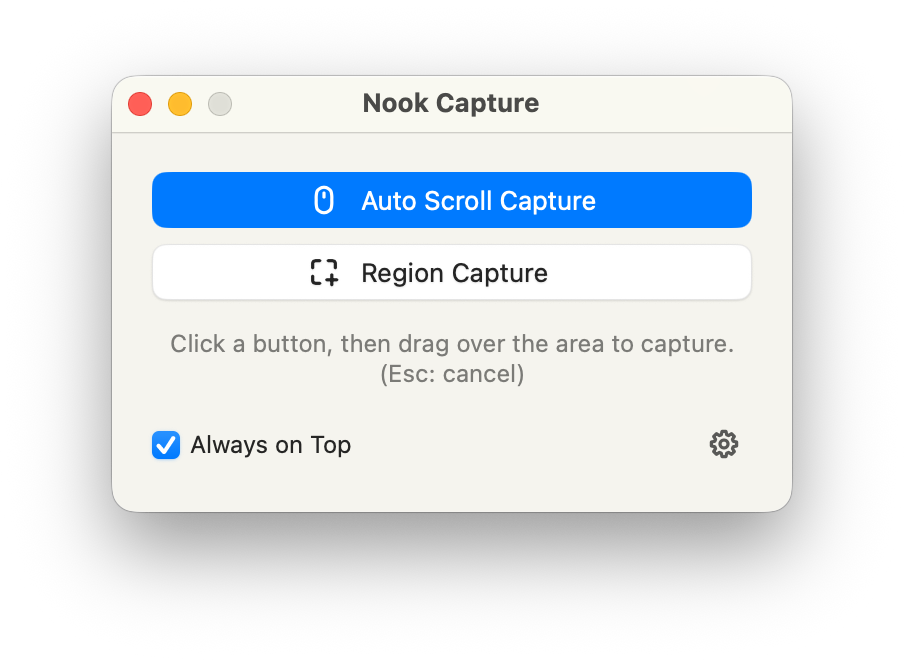
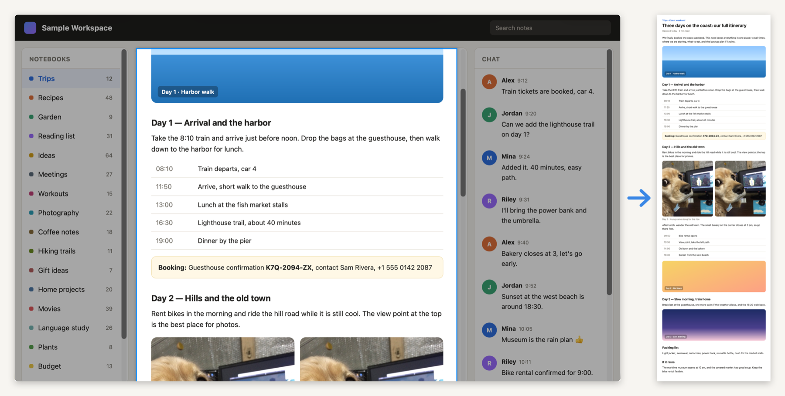
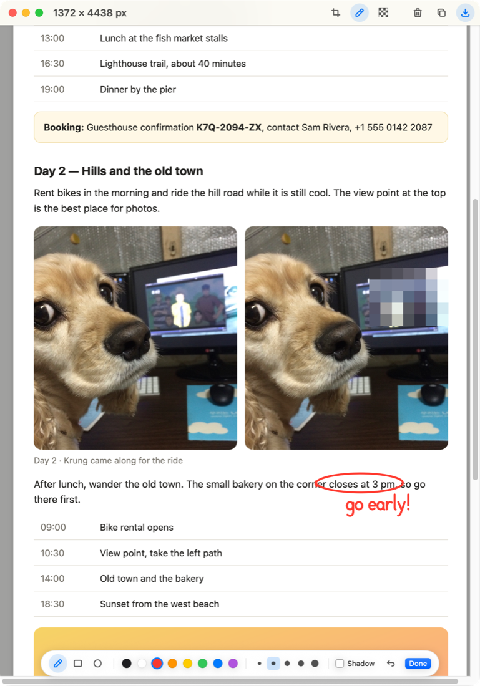

# Nook Capture

**Scroll-capture just the part you choose — free for macOS**

[English](#english) · [한국어](#한국어) · [中文](#中文) · [日本語](#日本語)

<a href="https://github.com/nanocenti/NookCapture/releases/latest"><b>⬇︎ Download the latest version</b></a>

A page with three scrolling areas: select only the middle one, and Nook Capture scrolls and stitches just that pane.

Hide part of a photo with mosaic and jot a quick note with the pen before saving.

---

## English

Many pages and apps have **several scrolling areas stacked inside one window**: a chat list next to a conversation, a sidebar inside a web page, a small list inside a panel.
With Nook Capture, **drag over just the part you want**, and it scrolls **that area only**, capturing as it goes and stitching everything into one tall image.
The rest of the window stays exactly where it is.

### Features
- **Capture only the scrolling area you choose** (⌘⇧1)
  - Works even on pages with multiple scrolling areas or overlapping windows. Select a part of one, and only that part is scrolled and captured.
  - Stops by itself when the area reaches its end. Click or press Esc to stop earlier.
  - Fixed parts inside the selection, such as title bars and input boxes, appear only once.
  - Tested with KakaoTalk, Telegram, and browsers such as Safari and Whale.
- **Region Capture** (⌘⇧2): capture a dragged area as a single image, with a magnifier for pixel-precise selection.
- **Preview editing**: crop, draw (pen, rectangle, circle), mosaic, undo (⌘Z)
- **Save & copy**: PNG / JPEG / HEIC, a fixed save folder or ask every time, copy to clipboard
- Lives in the menu bar (no Dock icon), optional launch at login
- English · 한국어 · 中文 · 日本語

### Install
1. Download `NookCapture.dmg` from [Releases](https://github.com/nanocenti/NookCapture/releases/latest).
2. Open the dmg and drag **Nook Capture** into **Applications**.
3. **One-time step on first launch.** Nook Capture is free and not notarized by Apple, so macOS blocks it the first time.
   1. Open Nook Capture from Applications. When the warning appears, click **Done**.
   2. Go to **System Settings → Privacy & Security** and click **Open Anyway** near the bottom.
   3. Open the app again and click **Open** in the confirmation dialog.

### Permissions
macOS asks for two permissions the first time you capture. Turn on Nook Capture in **System Settings → Privacy & Security**, then quit and relaunch the app once.

| Permission | Used for |
|---|---|
| Screen & System Audio Recording | Capturing the screen |
| Accessibility | Scrolling the selected area automatically, and stopping with a click or Esc |

### How to use
1. Press **⌘⇧1**, or choose **Auto Scroll Capture** from the menu bar icon.
2. Drag over the part you want to capture. It works best if you **scroll that part to its top first**.
3. Nook Capture scrolls the selected area while capturing and stops at the end. Click or press Esc to stop earlier.
4. Edit in the preview if needed, then **Save** or **Copy**.

### Good to know
- Content that loads only after the end is reached (infinite scrolling, etc.) is not captured.
- The result is limited to 50,000 px in height.
- If an always-visible scroll bar is inside the selection, its thumb can appear in every stitched strip. Select the area just inside the scroll bar.

### Requirements
macOS 13 or later on an Apple Silicon (M1 or later) Mac. Developed and tested on macOS 26.

### Feedback
Please open an [issue](https://github.com/nanocenti/NookCapture/issues).

### Terms
Nook Capture is **free** to use. The source code is not published. It is provided as is, without warranty of any kind.

---

## 한국어

한 창 안에 **스크롤 영역이 여러 개 겹겹이 있는 경우**가 많습니다. 채팅 목록 옆의 대화창, 웹페이지 안의 사이드바, 패널 속 작은 목록 같은 것들입니다.
Nook Capture는 **원하는 부분만 드래그로 선택하면 그 영역만 스크롤하면서** 연속으로 찍고, 하나의 긴 이미지로 이어 붙입니다.
창의 나머지 부분은 그대로 둡니다.

### 주요 기능
- **원하는 스크롤 영역만 골라서 캡처** (⌘⇧1)
  - 스크롤 영역이 여러 개인 페이지나 겹쳐 있는 창에서도, 그중 일부분만 선택하면 그 부분만 스크롤하며 캡처합니다.
  - 영역이 끝에 닿으면 스스로 멈춥니다. 중간에 멈추려면 클릭하거나 Esc를 누릅니다.
  - 선택 안의 제목줄·입력창처럼 고정된 부분은 한 번만 들어갑니다.
  - 카카오톡, 텔레그램, Safari·Whale 같은 브라우저에서 확인했습니다.
- **영역 지정 캡처** (⌘⇧2): 드래그한 영역을 한 장으로 찍습니다. 확대경으로 픽셀 단위로 맞출 수 있습니다.
- **미리보기 편집**: 자르기, 그리기(펜·사각형·원), 모자이크, 실행 취소(⌘Z)
- **저장·복사**: PNG / JPEG / HEIC, 저장 위치 지정 또는 매번 묻기, 클립보드로 복사
- 메뉴바에 상주(Dock 아이콘 없음), 로그인 시 자동 실행
- English · 한국어 · 中文 · 日本語 (처음 실행하면 영어, 설정에서 바꿀 수 있습니다)

### 설치
1. [Releases](https://github.com/nanocenti/NookCapture/releases/latest)에서 `NookCapture.dmg`를 받습니다.
2. dmg를 열고 **Nook Capture**를 **Applications** 폴더로 끌어 놓습니다.
3. **처음 실행할 때 한 번** 아래 과정이 필요합니다. 무료 배포라 Apple 공증을 받지 않아 macOS가 처음에는 실행을 막습니다.
   1. Applications에서 Nook Capture를 엽니다. 경고가 뜨면 **완료**를 누릅니다.
   2. **시스템 설정 → 개인정보 보호 및 보안**에서 아래쪽의 **"그래도 열기"** 를 누릅니다.
   3. 다시 열고, 확인 창에서 **열기**를 누릅니다.

### 권한
처음 캡처할 때 macOS가 두 가지 권한을 물어봅니다. **시스템 설정 → 개인정보 보호 및 보안**에서 Nook Capture를 켜고, 앱을 한 번 종료했다가 다시 실행해 주세요.

| 권한 | 쓰는 곳 |
|---|---|
| 화면 및 시스템 오디오 녹음 | 화면 캡처 |
| 손쉬운 사용 | 선택한 영역 자동 스크롤, 클릭·Esc로 멈추기 |

### 사용법
1. **⌘⇧1**을 누르거나 메뉴바 아이콘 → **Auto Scroll Capture(자동 스크롤 캡쳐)** 를 고릅니다.
2. 캡처할 부분만 드래그로 선택합니다. 그 부분을 **맨 위로 먼저 올려 두고** 시작하면 좋습니다.
3. 선택한 영역만 스크롤하며 찍고, 끝에 닿으면 멈춥니다. 중간에 멈추려면 클릭하거나 Esc를 누릅니다.
4. 미리보기에서 필요하면 편집한 뒤 **저장** 또는 **복사**합니다.

### 알아 두면 좋은 점
- 끝에 닿은 뒤 늦게 불러오는 내용(무한 스크롤 등)은 찍히지 않습니다.
- 결과 이미지는 최대 50,000px 높이까지 만듭니다.
- 항상 보이는 스크롤 막대를 선택에 넣으면 막대 모양이 이어 붙인 띠마다 찍힐 수 있습니다. 막대 바로 안쪽까지만 선택해 주세요.

### 요구 사항
macOS 13 이상, Apple Silicon(M1 이상) Mac. macOS 26에서 개발·테스트했습니다.

### 의견·버그 신고
[Issues](https://github.com/nanocenti/NookCapture/issues)에 남겨 주세요.

### 이용 조건
Nook Capture는 **무료**로 사용할 수 있습니다. 소스 코드는 공개하지 않습니다. 있는 그대로 제공되며, 어떠한 보증도 하지 않습니다.

---

## 中文

很多页面和应用的**同一个窗口里叠着好几个滚动区域**：聊天列表旁边的对话、网页里的侧边栏、面板中的小列表。
使用 Nook Capture，**只需拖动选中想要的那一部分**，它就会**只滚动该区域**并连续截图，最后拼接成一张长图。
窗口的其他部分保持不动。

### 主要功能
- **只截取你选中的滚动区域** (⌘⇧1)
  - 即使页面有多个滚动区域或窗口相互重叠，只选中其中一部分，也只会滚动并截取那一部分。
  - 区域滚动到底时自动停止。想提前停止时，点击鼠标或按 Esc。
  - 选区内的标题栏、输入框等固定部分只会出现一次。
  - 已在 KakaoTalk、Telegram 以及 Safari、Whale 等浏览器中测试。
- **区域截图** (⌘⇧2)：把拖动选中的区域截成一张图，可用放大镜精确到像素。
- **预览编辑**：裁剪、绘制（画笔、矩形、圆形）、马赛克、撤销 (⌘Z)
- **保存与复制**：PNG / JPEG / HEIC，可指定保存位置或每次询问，可复制到剪贴板
- 常驻菜单栏（无 Dock 图标），可设置登录时自动启动
- English · 한국어 · 中文 · 日本語（首次启动为英文，可在设置中更改）

### 安装
1. 从 [Releases](https://github.com/nanocenti/NookCapture/releases/latest) 下载 `NookCapture.dmg`。
2. 打开 dmg，把 **Nook Capture** 拖到 **应用程序 (Applications)** 文件夹。
3. **首次启动时需要操作一次。** Nook Capture 免费发布，未经过 Apple 公证，因此 macOS 第一次会阻止打开。
   1. 在“应用程序”中打开 Nook Capture，出现警告时点击 **完成**。
   2. 前往 **系统设置 → 隐私与安全性**，点击下方的 **仍要打开**。
   3. 再次打开应用，在确认对话框中点击 **打开**。

### 权限
第一次截图时 macOS 会请求两项权限。请在 **系统设置 → 隐私与安全性** 中打开 Nook Capture，然后退出并重新启动应用一次。

| 权限 | 用途 |
|---|---|
| 录屏与系统录音 | 截取屏幕 |
| 辅助功能 | 自动滚动选中的区域，以及点击或按 Esc 停止 |

### 使用方法
1. 按 **⌘⇧1**，或在菜单栏图标中选择 **Auto Scroll Capture（自动滚动截图）**。
2. 拖动选中想截取的部分。建议**先把该部分滚动到最顶部**再开始。
3. Nook Capture 只滚动选中的区域并截图，到底后自动停止。想提前停止时，点击鼠标或按 Esc。
4. 在预览中按需编辑后，点击 **保存** 或 **复制**。

### 注意事项
- 到底之后才加载的内容（无限滚动等）不会被截取。
- 结果图片高度最多 50,000 像素。
- 如果选区内有始终显示的滚动条，滚动条的滑块可能会出现在每一段拼接中。请只选到滚动条内侧。

### 系统要求
macOS 13 或更高版本，Apple 芯片（M1 或更新）的 Mac。在 macOS 26 上开发和测试。

### 反馈
请在 [Issues](https://github.com/nanocenti/NookCapture/issues) 中留言。

### 使用条款
Nook Capture **免费**使用，不公开源代码。按“现状”提供，不提供任何形式的保证。

---

## 日本語

1つのウィンドウの中に**スクロール領域が何層も重なっている**ことはよくあります。チャット一覧の横の会話、Webページ内のサイドバー、パネルの中の小さなリストなどです。
Nook Capture なら、**必要な部分だけをドラッグで選ぶと、その領域だけをスクロール**しながら連続でキャプチャし、1枚の縦長画像につなげます。
ウィンドウのほかの部分はそのままです。

### 主な機能
- **選んだスクロール領域だけをキャプチャ** (⌘⇧1)
  - スクロール領域が複数あるページや重なったウィンドウでも、その一部だけを選べば、その部分だけをスクロールしてキャプチャします。
  - 領域が最後まで届くと自動で止まります。途中で止めるにはクリックするか Esc を押します。
  - 選択範囲内のタイトルバーや入力欄などの固定部分は1回だけ入ります。
  - KakaoTalk、Telegram、Safari・Whale などのブラウザで確認済みです。
- **範囲指定キャプチャ** (⌘⇧2)：ドラッグした範囲を1枚で撮影します。ルーペでピクセル単位まで合わせられます。
- **プレビュー編集**：切り取り、描画（ペン・四角・円）、モザイク、取り消し (⌘Z)
- **保存・コピー**：PNG / JPEG / HEIC、保存先の指定または毎回確認、クリップボードへコピー
- メニューバーに常駐（Dock アイコンなし）、ログイン時に自動起動
- English · 한국어 · 中文 · 日本語（初回起動は英語、設定で変更できます）

### インストール
1. [Releases](https://github.com/nanocenti/NookCapture/releases/latest) から `NookCapture.dmg` をダウンロードします。
2. dmg を開き、**Nook Capture** を **アプリケーション (Applications)** フォルダへドラッグします。
3. **初回起動時に一度だけ**次の操作が必要です。Nook Capture は無料配布で Apple の公証を受けていないため、macOS が最初は起動をブロックします。
   1. アプリケーションから Nook Capture を開き、警告が出たら **完了** をクリックします。
   2. **システム設定 → プライバシーとセキュリティ** を開き、下の方にある **このまま開く** をクリックします。
   3. もう一度アプリを開き、確認ダイアログで **開く** をクリックします。

### 権限
初めてキャプチャするときに、macOS が2つの権限を求めます。**システム設定 → プライバシーとセキュリティ** で Nook Capture をオンにし、アプリを一度終了してから起動し直してください。

| 権限 | 用途 |
|---|---|
| 画面とシステムオーディオの録音 | 画面のキャプチャ |
| アクセシビリティ | 選択した領域の自動スクロール、クリック・Esc での停止 |

### 使い方
1. **⌘⇧1** を押すか、メニューバーのアイコンから **Auto Scroll Capture（自動スクロールキャプチャ）** を選びます。
2. キャプチャしたい部分だけをドラッグで選びます。その部分を**先に一番上までスクロールしておく**と確実です。
3. 選んだ領域だけをスクロールしながら撮影し、最後で止まります。途中で止めるにはクリックするか Esc を押します。
4. プレビューで必要に応じて編集し、**保存** または **コピー** します。

### 注意点
- 最後まで届いたあとに読み込まれる内容（無限スクロールなど）はキャプチャされません。
- 結果画像の高さは最大 50,000px です。
- 常に表示されるスクロールバーを選択範囲に入れると、つなぎ目ごとにスクロールバーのつまみが写ることがあります。スクロールバーのすぐ内側までを選んでください。

### 動作環境
macOS 13 以降、Apple シリコン（M1 以降）搭載の Mac。macOS 26 で開発・テストしています。

### フィードバック
[Issues](https://github.com/nanocenti/NookCapture/issues) にお寄せください。

### 利用条件
Nook Capture は**無料**で使えます。ソースコードは公開していません。現状のまま提供され、いかなる保証もありません。
